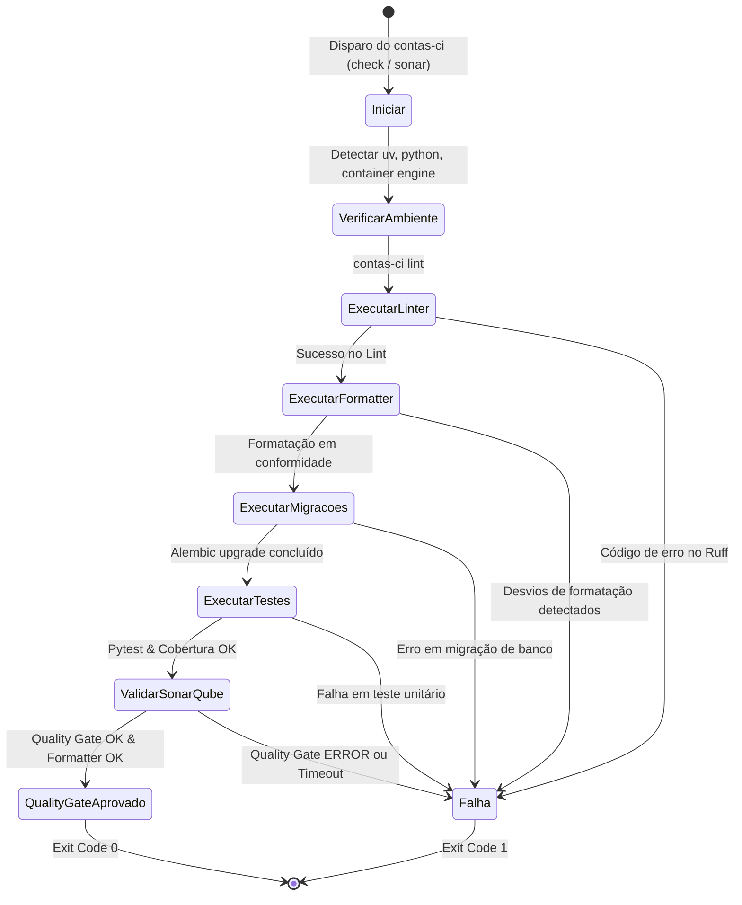

# Data Model: Estruturas de Dados da CLI em Go (022-golang-cicd)

**Feature**: `022-golang-cicd`  
**Data**: 2026-11-14  
**Status**: Concluído

Este documento descreve os modelos de dados, estruturas tipadas em Go e estados de transição utilizados pela ferramenta CLI `contas-ci`.

---

## 1. Modelos do Pipeline de Execução

### `PipelineStep`
Representa uma etapa atômica de validação ou build.

```go
type StepStatus string

const (
    StatusPending StepStatus = "PENDING"
    StatusRunning StepStatus = "RUNNING"
    StatusSuccess StepStatus = "SUCCESS"
    StatusFailed  StepStatus = "FAILED"
    StatusSkipped StepStatus = "SKIPPED"
)

type PipelineStep struct {
    Name        string            // Identificador do passo (ex: "lint", "format-check", "migration", "test", "sonar")
    Description string            // Descrição legível para o usuário
    Command     string            // Executável a chamar (ex: "uv", "podman", "docker")
    Args        []string          // Argumentos da linha de comando
    Env         map[string]string // Variáveis de ambiente complementares
    WorkingDir  string            // Diretório de execução (padrão: raiz do projeto)
    Timeout     time.Duration     // Tempo limite de execução
    Required    bool              // Se true, falha neste passo aborta a esteira
}
```

### `StepResult` e `PipelineReport`
Registram a saída estruturada e telemetria da execução.

```go
type StepResult struct {
    StepName  string        `json:"step_name"`
    Status    StepStatus    `json:"status"`
    Duration  time.Duration `json:"duration_ms"`
    ExitCode  int           `json:"exit_code"`
    StdOut    string        `json:"stdout,omitempty"`
    StdErr    string        `json:"stderr,omitempty"`
    Error     string        `json:"error,omitempty"`
}

type PipelineReport struct {
    StartTime time.Time     `json:"start_time"`
    EndTime   time.Time     `json:"end_time"`
    Duration  time.Duration `json:"total_duration"`
    OverallOK bool          `json:"overall_ok"`
    Results   []StepResult  `json:"results"`
}
```

---

## 2. Modelos de Integração com SonarQube

### `SonarConfig`
Configuração consolidada de conexão e análise.

```go
type SonarConfig struct {
    HostURL         string        // URL base do SonarQube (ex: "http://192.168.1.20:9000" ou "http://localhost:9000")
    Token           string        // Token de autenticação Bearer/Basic
    ProjectKey      string        // Chave do projeto no SonarQube (padrão: "contas")
    ProjectDir      string        // Caminho absoluto da raiz do repositório
    ContainerEngine string        // "podman" ou "docker"
    QualityProfile  string        // Nome do Quality Profile customizado
    Timeout         time.Duration // Timeout máximo de polling do Quality Gate
}
```

### Modelos de Resposta da API REST do SonarQube

```go
// GET /api/system/status
type SystemStatusResponse struct {
    Status string `json:"status"` // "UP", "STARTING", "DOWN"
}

// GET /api/authentication/validate
type AuthValidationResponse struct {
    Valid bool `json:"valid"`
}

// GET /api/ce/component?component=contas
type ComputeEngineTask struct {
    ID           string `json:"id"`
    Type         string `json:"type"`
    ComponentKey string `json:"componentKey"`
    Status       string `json:"status"` // "SUCCESS", "FAILED", "PENDING", "IN_PROGRESS"
}

type ComputeEngineResponse struct {
    Current Task `json:"current"`
    Queue   []Task `json:"queue"`
}

// GET /api/qualitygates/project_status?projectKey=contas
type QualityGateCondition struct {
    MetricKey      string `json:"metricKey"`
    Status         string `json:"status"` // "OK", "ERROR"
    ActualValue    string `json:"actualValue"`
    ErrorThreshold string `json:"errorThreshold"`
    Comparator     string `json:"comparator"`
}

type ProjectStatus struct {
    Status     string                 `json:"status"` // "OK", "ERROR"
    Conditions []QualityGateCondition `json:"conditions"`
}

type QualityGateResponse struct {
    ProjectStatus ProjectStatus `json:"projectStatus"`
}
```

---

## 3. Diagrama de Transição de Estados do Pipeline


