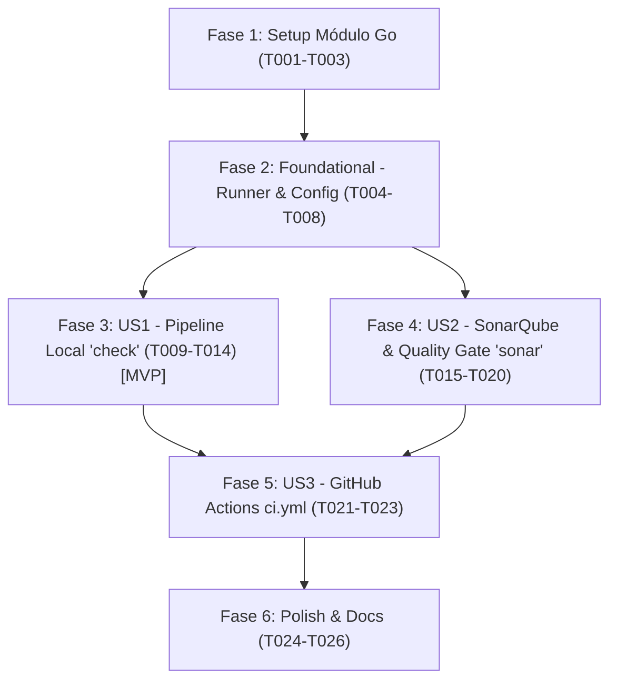

# Tasks: Migração e Unificação do CI/CD com Go Lang (022-golang-cicd)

**Input**: Design documents from `/specs/022-golang-cicd/`  
**Prerequisites**: [plan.md](plan.md), [spec.md](spec.md), [research.md](research.md), [data-model.md](data-model.md), [contracts/cli.md](contracts/cli.md), [quickstart.md](quickstart.md)  
**Tests**: Testes unitários em Go incluídos para os pacotes de configuração, execução e integração com SonarQube.

---

## Format: `[ID] [P?] [Story] Description`
- **[P]**: Pode rodar em paralelo (arquivos distintos, sem dependência mútua)
- **[Story]**: Identificador da User Story (US1, US2, US3)

---

## Phase 1: Setup (Módulo Go & Estrutura Inicial)

**Purpose**: Inicialização do módulo Go e arquitetura de pacotes da ferramenta CLI.

- [x] T001 Inicializar módulo Go `contas/tools/ci` e dependências em `tools/ci/go.mod`
- [x] T002 Adicionar dependência `github.com/spf13/cobra` para CLI em `tools/ci/go.mod`
- [x] T003 Criar estrutura de diretórios em `tools/ci/cmd/ci` e `tools/ci/internal/{config,runner,sonar,pipeline}`

---

## Phase 2: Foundational (Infraestrutura Compartilhada)

**Purpose**: Componentes fundamentais de resolução de configuração, execução de processos e comando raiz.

- [x] T004 Implementar resolução com prioridade do `SONAR_TOKEN` (env -> `.env` -> `.sonar_token` -> `.sonar_remote_token`) em `tools/ci/internal/config/token.go`
- [x] T005 [P] Criar testes unitários para a resolução de tokens em `tools/ci/internal/config/token_test.go`
- [x] T006 Implementar executor de comandos do sistema com suporte a streaming e cancelamento por timeout em `tools/ci/internal/runner/executor.go`
- [x] T007 [P] Criar testes unitários para o executor de comandos em `tools/ci/internal/runner/executor_test.go`
- [x] T008 Implementar o comando raiz Cobra da CLI com flags globais (`--verbose`, `--dir`) em `tools/ci/cmd/ci/root.go` e ponto de entrada em `tools/ci/cmd/ci/main.go`

---

## Phase 3: User Story 1 - Execução e Orquestração Local do Pipeline (Priority: P1) 🎯 MVP

**Goal**: Permitir que desenvolvedores executem linter (`ruff`), formatação (`sonar_formatter_check`), migrações (`alembic`) e testes com cobertura (`pytest`) via subcomandos da CLI Go.

**Independent Test**: Executar `go run ./tools/ci/cmd/ci check` e verificar a execução de todos os passos com código de saída 0 em caso de sucesso.

- [x] T009 [P] [US1] Implementar subcomando `contas-ci lint` invocando `uv run ruff check .` em `tools/ci/internal/pipeline/lint.go`
- [x] T010 [P] [US1] Implementar subcomando `contas-ci format-check` invocando `sonar_formatter_check.py` em `tools/ci/internal/pipeline/format.go`
- [x] T011 [US1] Implementar subcomando `contas-ci test` orquestrando migrações (`alembic upgrade head`) e testes (`pytest -v --cov=src/contas`) em `tools/ci/internal/pipeline/test.go`
- [x] T012 [US1] Implementar subcomando `contas-ci check` orquestrando a sequência ordenada de `lint`, `format-check` e `test` em `tools/ci/internal/pipeline/check.go`
- [x] T013 [P] [US1] Conectar os comandos `check`, `lint`, `format-check` e `test` à CLI principal em `tools/ci/cmd/ci/check.go`
- [x] T014 [US1] Criar testes unitários e de integração leve para o fluxo de orquestração do pipeline em `tools/ci/internal/pipeline/check_test.go`

---

## Phase 4: User Story 2 - Integração com SonarQube e Quality Gate (Priority: P2)

**Goal**: Substituir integralmente o script `sonar_check.sh` por rotinas em Go que realizam health check, configuração de profile/regras, execução do scanner via container e polling do Quality Gate.

**Independent Test**: Executar `go run ./tools/ci/cmd/ci sonar` contra o servidor SonarQube e verificar a validação bem-sucedida do Quality Gate.

- [x] T015 [US2] Implementar cliente HTTP REST tipado para SonarQube (`/api/system/status`, `/api/authentication/validate`, `/api/projects/create`, `/api/qualityprofiles/*`) com retries e backoff exponencial em `tools/ci/internal/sonar/client.go`
- [x] T016 [P] [US2] Criar testes unitários com mock HTTP server para o cliente SonarQube em `tools/ci/internal/sonar/client_test.go`
- [x] T017 [US2] Implementar normalização de caminhos no `coverage.xml` e orquestrador do container SonarScanner (`podman` / `docker`) em `tools/ci/internal/sonar/scanner.go`
- [x] T018 [US2] Implementar polling assíncrono e verificação do status final do Quality Gate (`/api/qualitygates/project_status`) em `tools/ci/internal/sonar/quality_gate.go`
- [x] T019 [US2] Implementar subcomando `contas-ci sonar` com flags (`--sonar-url`, `--token`, `--skip-scanner`, `--timeout`) em `tools/ci/cmd/ci/sonar.go`
- [x] T020 [US2] Atualizar o script raiz `sonar_check.sh` para atuar como wrapper fino retrocompatível delegando para `go run ./tools/ci/cmd/ci sonar "$@"` em `sonar_check.sh`

---

## Phase 5: User Story 3 - Integração nos Workflows do GitHub Actions (Priority: P3)

**Goal**: Integrar a CLI Go nos jobs do GitHub Actions, eliminando blocos verbosos de shell script e garantindo que o CI utilize exatamente a mesma lógica do ambiente local.

**Independent Test**: Simular o pipeline remoto com os comandos da CLI Go e verificar a execução simplificada do workflow `.github/workflows/ci.yml`.

- [x] T021 [US3] Atualizar job `build-and-test` em `.github/workflows/ci.yml` configurando step `actions/setup-go@v5` e substituindo scripts inline por `go run ./tools/ci/cmd/ci check`
- [x] T022 [US3] Atualizar job `sonarqube` em `.github/workflows/ci.yml` substituindo blocos de curl/password change/token por `go run ./tools/ci/cmd/ci sonar --sonar-url "http://localhost:9000"`
- [x] T023 [US3] Validar que artefatos de cobertura (`coverage.xml`, `ruff-report.json`, `sonar-formatter-issues.json`) continuam gerados e compatíveis com os steps de PR e Release existentes em `.github/workflows/ci.yml`

---

## Phase 6: Polish & Cross-Cutting Concerns

**Purpose**: Unificação final, documentação e garantia de conformidade de código e formatação.

- [x] T024 Implementar subcomando unificado `contas-ci all` executando `check` e `sonar` sequencialmente em `tools/ci/cmd/ci/all.go`
- [x] T025 [P] Atualizar documentação do projeto (`README.md`) com a seção de uso e comandos da nova CLI em Go
- [x] T026 Executar `go vet ./...` e `go test ./...` em `tools/ci` garantindo 100% dos testes e conformidade do código Go

---

## Dependencies & Completion Order

### Oportunidades de Execução Paralela
- **T005** (testes de token) pode rodar em paralelo com **T007** (testes do runner).
- **T009** (lint) e **T010** (format-check) podem ser implementados em paralelo.
- **T016** (mock HTTP tests) pode rodar em paralelo com **T017** (container scanner).
- **T025** (documentação no README) pode ser elaborado em paralelo com **T024** (subcomando `all`).

---

## Implementation Strategy & MVP

1. **Escopo MVP (Fases 1, 2 e 3)**:
   - Entrega a CLI Go com capacidade de rodar `contas-ci check` localmente.
   - O desenvolvedor já pode substituir chamadas manuais de `ruff` e `pytest` por uma única execução determinística.
2. **Entrega Incremental (Fase 4)**:
   - Adiciona o subcomando `contas-ci sonar`, substituindo o script frágil `sonar_check.sh`.
3. **Entrega Final (Fases 5 e 6)**:
   - Simplifica o workflow do GitHub Actions e entrega paridade 100% entre CI e local.
