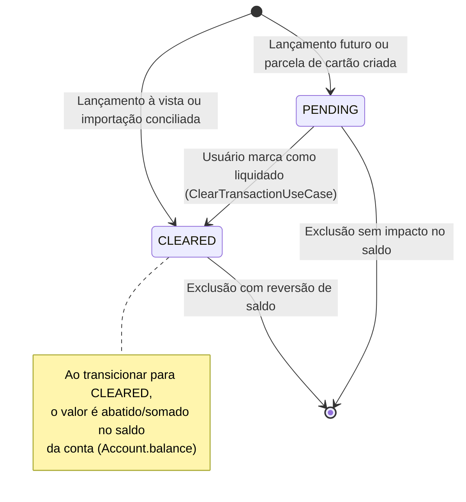

# Data Model: Filtros de Quitação e Saldo Projetado (023-settlement-filters)

## Entidades & Schemas

### 1. Evolução do Schema `GetStatementInput`

Localização: `src/contas/schemas/transaction.py`

```python
class StatementStatusFilter(StrEnum):
    ALL = "all"
    CLEARED = "cleared"
    PENDING = "pending"


class GetStatementInput(BaseModel):
    model_config = ConfigDict(extra="forbid", str_strip_whitespace=True)

    account_id: UUID = Field(..., description="UUID of the account")
    start_date: str = Field(..., description="Start date (YYYY-MM-DD or ISO 8601)")
    end_date: str = Field(..., description="End date (YYYY-MM-DD or ISO 8601)")
    include_pending: bool = Field(
        default=True,
        description="Legacy flag to include pending transactions. Superseded by status_filter when provided.",
    )
    status_filter: StatementStatusFilter = Field(
        default=StatementStatusFilter.ALL,
        description="Filter transactions by settlement status: 'all', 'cleared', or 'pending'.",
    )
    limit: int = Field(default=500, ge=1, le=1000)
    date_type: str = Field(default="transaction_date")
    search: str | None = Field(default=None)
    user_id: UUID | None = Field(default=None)
```

---

### 2. Schema de Projeção de Conta (`AccountBalanceProjection`)

Localização: `src/contas/schemas/account.py` (ou `src/contas/schemas/transaction.py`)

```python
class AccountBalanceProjection(BaseModel):
    model_config = ConfigDict(extra="forbid")

    account_id: UUID
    account_name: str
    account_type: str
    current_balance: Decimal
    pending_income: Decimal
    pending_expense: Decimal
    pending_transfers_net: Decimal
    projected_balance: Decimal
    is_projected_negative: bool


class DashboardProjectionsResponse(BaseModel):
    model_config = ConfigDict(extra="forbid")

    reference_date: str
    total_current_balance: Decimal
    total_pending_income: Decimal
    total_pending_expense: Decimal
    total_projected_balance: Decimal
    accounts: list[AccountBalanceProjection]
```

---

### 3. Entidades de Domínio Envolvidas

#### `Account`
- `id`: UUID (chave primária)
- `user_id`: UUID (isolamento multi-tenant)
- `name`: str
- `account_type`: AccountType (CHECKING, SAVINGS, CREDIT_CARD, INVESTMENT, CASH)
- `balance`: Decimal (saldo atual realizado com base em transações liquidadas)
- `is_active`: bool

#### `Transaction`
- `id`: UUID
- `user_id`: UUID
- `amount`: Decimal(14, 2)
- `transaction_type`: TransactionType (`income`, `expense`, `transfer`)
- `status`: TransactionStatus (`cleared`, `pending`)
- `transaction_date`: datetime
- `due_date`: datetime | None
- `source_account_id`: UUID
- `destination_account_id`: UUID | None

---

## Máquina de Estados e Transições



---

## Regras de Validação

1. **Consistência de Filtro de Status**:
   - `status_filter == "pending"`: retorna unicamente transações com status `pending`.
   - `status_filter == "cleared"`: retorna unicamente transações com status `cleared`.
   - `status_filter == "all"`: considera o parâmetro `include_pending` (se `True`, traz ambas; se `False`, apenas `cleared`).
2. **Precisão de Arredondamento**:
   - Todo somatório em `StatementSummary` e `AccountBalanceProjection` deve utilizar `Decimal("0.00")` com quantização em duas casas decimais (`ROUND_HALF_UP`).
3. **Isolamento de Tenant**:
   - O cálculo de transações pendentes de uma conta deve estritamente filtrar por `user_id` para impedir vazamento entre usuários.
