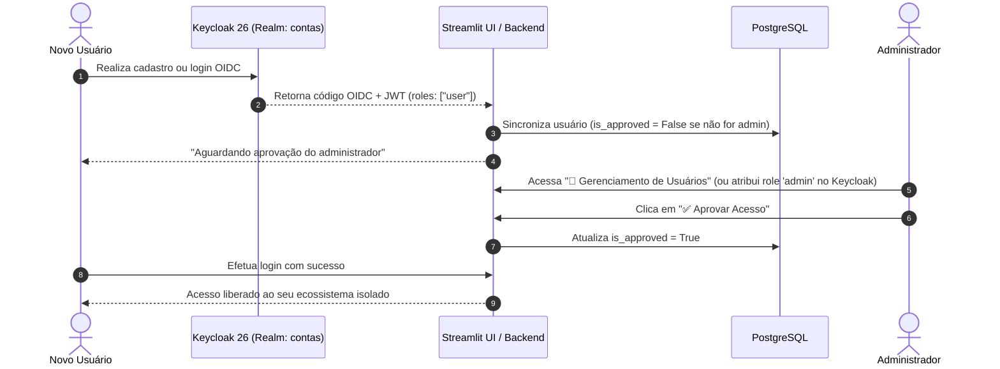

# 🔐 03. Autenticação, Keycloak e Multi-Tenant

Para garantir privacidade total em ambientes locais compartilhados ou em servidores expostos em rede, o **Contas** implementa uma camada completa de **Autenticação via Keycloak (OpenID Connect), Controle de Acesso Baseado em Roles (RBAC) e Isolamento Multi-Tenant**.

---

## 🏢 Isolamento Estrito por `user_id`

No **Contas**, não existe compartilhamento ou visibilidade cruzada entre contas de usuários diferentes:
- Toda e qualquer tabela relacional de dados (`account`, `category`, `budget`, `transaction`) possui uma coluna obrigatória `user_id: UUID` com chave estrangeira indexada para a tabela `user`.
- Todas as operações de leitura (`SELECT`), escrita (`INSERT`), atualização (`UPDATE`), liquidação (`clear_transaction`) e exclusão (`DELETE`) nos repositórios SQLAlchemy filtram obrigatoriamente por `.where(Model.user_id == current_user_id)`.
- É tecnicamente impossível para o `Usuário B` consultar ou alterar o saldo, extrato ou orçamentos do `Usuário A`.

---

## 🛡️ Provedor de Identidade Centralizado: Keycloak 26 (OIDC)

O gerenciamento de usuários e autenticação é realizado pelo **Keycloak 26** rodando na porta `8180` (para não conflitar com outros serviços na porta `8080`):
- **Realm Automático (`contas`)**: Na primeira inicialização do container `contas-keycloak`, o arquivo `docker/keycloak/contas-realm.json` é importado automaticamente, configurando o realm `contas`, as roles `admin` e `user`, e o client OIDC `contas-app`.
- **Dois Modos de Autenticação Integrados**:
  1. **SSO via Navegador (Authorization Code Flow)**: Ao clicar em **"🔐 Entrar com Keycloak (SSO)"** ou **"🔐 Cadastrar via Keycloak"**, o usuário é redirecionado para o Keycloak (`KEYCLOAK_SERVER_URL`). No retorno com `?code=...`, o backend troca o código por `access_token` e `id_token` via rede interna (`KEYCLOAK_INTERNAL_URL`).
  2. **Login Direto na Tela (Direct Access Grant)**: O formulário de usuário/e-mail e senha tenta autenticar primeiro no Keycloak via *Resource Owner Password Credentials* e, caso o usuário seja apenas local, faz fallback transparente para o banco PostgreSQL (`bcrypt`).
- **Suporte a Split-Horizon DNS**: O serviço `KeycloakOAuthService` separa `KEYCLOAK_SERVER_URL` (URL pública/LAN acessível pelo navegador, ex: `http://localhost:8180` ou `http://192.168.1.20:8180`) de `KEYCLOAK_INTERNAL_URL` (`http://keycloak:8080` na rede interna dos containers), extraindo claims e roles diretamente dos tokens JWT OIDC (`id_token` e `access_token`).

---

## ⏳ Fluxo de Aprovação Prévia e Mapeamento de Roles

Para impedir que acessos indevidos sejam liberados automaticamente na rede, o sistema opera sob o modelo de **aprovação prévia e RBAC**:

### Regras do Fluxo:
1. **Primeiro Usuário (Bootstrap)**: O primeiro usuário registrado no banco recebe automaticamente `role = "admin"` e `is_approved = True`.
2. **Role `admin` no Keycloak**: Qualquer usuário que possua a role `admin` atribuída no Keycloak (`realm_access.roles` ou `resource_access`) é automaticamente promovido a `role = "admin"` e aprovado (`is_approved = True`) ao fazer login.
3. **Novos Usuários Comuns**: Cadastros subsequentes sem a role `admin` nascem com `is_approved = False` até liberação pelo Administrador.

---

## 🔒 Segurança de Senhas Locais

- Para contas locais (fallback), as senhas são processadas pelo algoritmo `bcrypt` com fator de custo 12 (`rounds=12`) e geração aleatória de salt por credencial.
- O hash é irreversível e verificado via `bcrypt.checkpw()`.
- Usuários autenticados podem atualizar suas próprias senhas no menu de configurações, exigindo validação da senha anterior.
