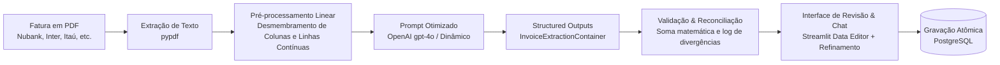

# 🧾 04. Parser de Faturas e IA

A importação manual de despesas de cartão de crédito é um dos maiores pontos de atrito no controle financeiro pessoal. O **Contas** resolve esse desafio com um pipeline automatizado que combina processamento local de documentos em Python (`pypdf` e regex linear) com a inteligência multimodal e estruturada do modelo **OpenAI `gpt-4o`** (com suporte a carregamento dinâmico de modelos).

---

## ⚙️ Arquitetura do Pipeline de Extração

---

## 🧠 Modelos de IA e Carregamento Dinâmico

O sistema adota o modelo **`gpt-4o`** como padrão, combinando alta velocidade, precisão multimodal e suporte a saídas estruturadas estritas (*Structured Outputs*):

1. **Carregamento Dinâmico via API**: A interface consulta diretamente os modelos disponíveis na conta da OpenAI (`client.models.list()`), filtrando apenas modelos de chat compatíveis (`gpt-4*`, `o1*`) e excluindo modelos obsoletos ou incompatíveis (`whisper`, `embedding`, `o3-mini`, etc.).
2. **Cache em Memória & Botão Refresh (🔄)**: A lista de modelos é cacheada por 1 hora para evitar requisições redundantes a cada interação da UI, com botão manual de atualização com feedback instantâneo.
3. **Fallback Resiliente**: Caso a chave da API esteja temporariamente indisponível ou ocorra falha de rede, o sistema opera com fallback seguro (`gpt-4o`, `gpt-4o-mini`, `o1`).

---

## 🛡️ Defesas Anti-Alucinação, Integridade e Resiliência a Faturas Brasileiras

Modelos de linguagem requerem defesas rigorosas para manipulação contábil:

1. **Pré-Processamento Linear de Colunas e Parágrafos Concatenados (`preprocess_invoice_text`)**:
   - Faturas como as do Itaú/LuizaCred frequentemente apresentam múltiplas transações em colunas paralelas ou agrupadas em bloco corrido sem quebras de linha (`\n`). O pré-processador linear identifica padrões de data (`DD/MM`), estabelecimentos e valores, isolando cada lançamento em uma linha independente antes do envio ao modelo.
2. **Compras Parceladas com Datas Anteriores (Regra Anti-Omissão)**:
   - Em cartões brasileiros, compras parceladas exibem a data da compra original (meses ou ano anterior). O prompt instrui expressamente o modelo a nunca descartar despesas da seção corrente por terem data anterior ao fechamento da fatura (marcando-as corretamente com `is_future=False`).
3. **Teto de Saída Estendido (`max_completion_tokens=16384`)**:
   - Garante capacidade de resposta para faturas volumosas (mais de 100 lançamentos entre compras atuais e parcelas futuras) sem cortes prematuros de JSON.
4. **Reconciliação Matemática Automática**:
   - O sistema calcula a soma dos itens extraídos da fatura atual e compara com o valor total informado no cabeçalho/resumo do documento, registrando log detalhado de conferência (`RECONCILIAÇÃO PERFEITA ✅` ou alerta de divergência).
5. **Revisão Humana e Chat de Refinamento (Human-in-the-Loop)**:
   - Tabela interativa (`st.data_editor`) e assistente de chat para filtrar, recategorizar e marcar despesas antes da persistência final no banco.
