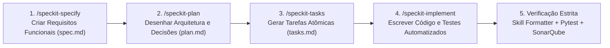

# 📐 06. Metodologia Spec-Driven

Todo o desenvolvimento do **Contas** é guiado pela metodologia **Spec-Driven Development (SDD)** utilizando o framework **GitHub Spec Kit**, combinado com regras automatizadas de qualidade e formatação.

---

## 🔄 O Ciclo de Desenvolvimento

Diferente do desenvolvimento convencional guiado por código imediato (onde arquitetura e escopo se perdem facilmente), o fluxo do Spec Kit estabelece clareza em 5 fases sequenciais:



---

## 📁 Estrutura de cada Especificação

Cada funcionalidade desenvolvida no projeto possui sua própria pasta versionada dentro do diretório `specs/`:

```text
specs/
├── 015-edit-account-name/
├── 016-multi-tenant-auth/
├── 017-auth-google-oauth-and-registration/
├── 018-google-oauth-and-change-password/
├── 019-github-wiki-and-portfolio-readme/
├── 020-clear-transaction-and-multi-tenant-fixes/
└── 021-keycloak-identity-and-auth/
    ├── spec.md        # Especificação detalhada com Requisitos Funcionais e Critérios de Sucesso
    ├── plan.md        # Desenho de arquitetura, contratos e fluxos envolvidos
    └── tasks.md       # Lista de tarefas atômicas executadas com marcação de progresso [x]
```

---

## 🛠️ Skills e Regras do Agente (`.agents/`)

O projeto define customizações nativas em `.agents/` para garantir consistência em todas as entregas:
- **Regra Sempre Ativa (`.agents/rules/formatter.md`)**: Exige que toda alteração passe pelo formatador e linter antes de qualquer commit ou análise no SonarQube.
- **Skill de Formatter (`.agents/skills/formatter/SKILL.md`)**: Script automatizado (`sonar_formatter_check.py`) que executa `ruff check` + `ruff format` e exporta relatórios JSON compatíveis com o SonarQube (`ruff-report.json` e `sonar-formatter-issues.json`).

---

## 📜 Princípios da Constituição do Projeto

O repositório é regido por regras inegociáveis registradas em `.specify/memory/constitution.md`:
1. **YAGNI & Simplicidade**: Nenhuma abstração desnecessária sem aplicação imediata comprovada.
2. **Precisão Matemática**: Proibição de ponto flutuante binário (`float`) para valores monetários; uso estrito de `Decimal`.
3. **Idiomas Bem Definidos**:
   - Documentações, especificações e Wiki em **Português do Brasil (PT-BR)**.
   - Código-fonte, variáveis, funções, classes, schemas e testes em **Inglês (EN-US)**.
