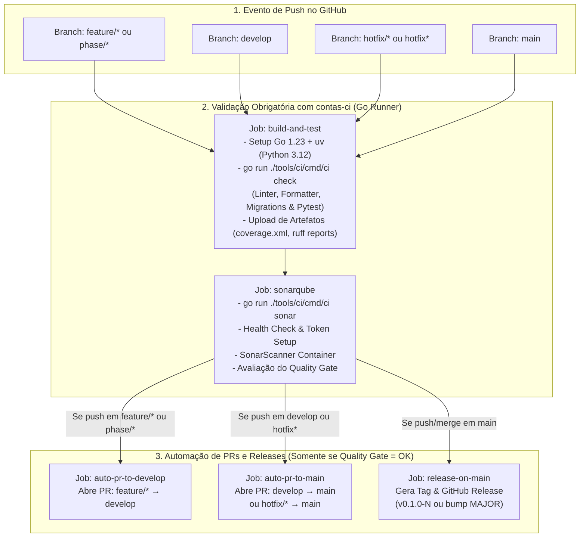

# 🔄 07. Gitflow, CI/CD e Qualidade (SonarQube & Go Runner)

O **Contas** possui uma esteira completa de **Integração e Entrega Contínua (CI/CD)** no GitHub Actions (`.github/workflows/ci.yml`), integrando um modelo **Gitflow automatizado**, orquestração tipada em **Go Lang (`contas-ci`)**, **Quality Gate do SonarQube**, **geração automática de Pull Requests e Releases** e sincronização automática da **Wiki**.

---

## 🌿 Estrutura de Branches (Gitflow)

O repositório organiza o ciclo de vida do código nas seguintes branches:

| Branch / Padrão | Origem | Destino (PR Automático) | Finalidade |
| :--- | :--- | :--- | :--- |
| **`feature/*`** e **`phase/*`** | `develop` | `develop` | Desenvolvimento de novas funcionalidades e fases da metodologia Spec-Driven (ex: `feature/022-golang-cicd`). |
| **`develop`** | `main` | `main` | Branch de integração contínua onde as features validadas são consolidadas. |
| **`hotfix/*`** e **`hotfix*`** | `main` | **`main` (Direto)** | Correções urgentes de produção que precisam gerar uma nova Release imediatamente sem aguardar o ciclo da `develop`. |
| **`main`** | `develop` ou `hotfix/*` | *GitHub Release (`v*`)* | Branch estável de produção. Todo push/merge na `main` dispara a criação automática de uma nova Release. |

---

## ⚙️ Fluxo Completo da Esteira de CI/CD



---

## 🛠️ A Ferramenta de CI/CD em Go (`contas-ci`)

Para eliminar dezenas de linhas de scripts Bash complexos, comandos `curl` e regex frágeis, o projeto adota uma CLI modular em Go localizada em `tools/ci/`:

- **Módulo Independente (`tools/ci/go.mod`)**: Não mistura dependências com o ecossistema Python (`pyproject.toml`).
- **Resolução Inteligente de Credenciais (`tools/ci/internal/config/token.go`)**: Resolve `SONAR_TOKEN` com estrita prioridade (`env` -> `.env` -> `.sonar_token` -> `.sonar_remote_token`) e armazena com permissão segura `0600`.
- **Cliente HTTP Nativo com Retries (`tools/ci/internal/sonar/client.go`)**: Realiza health check resiliente com backoff exponencial, provisionamento de tokens efêmeros no CI e verificação do Quality Gate.
- **Normalização de Cobertura e Scanner (`tools/ci/internal/sonar/scanner.go`)**: Mapeia deterministamente os caminhos do `coverage.xml` para a raiz do container `/usr/src` e detecta Podman ou Docker.

### Comandos da CLI

| Comando | Descrição |
|:---|:---|
| `contas-ci check` | Executa a validação completa local: lint (`ruff check`), formatação (`sonar_formatter_check`), migrações (`alembic`) e testes com cobertura (`pytest`). |
| `contas-ci lint` | Executa apenas o linter estático via `ruff check .`. |
| `contas-ci format-check` | Executa apenas a verificação de formatação e gera os relatórios SonarFormatter. |
| `contas-ci test` | Aplica migrações e executa a suíte de testes com geração de `coverage.xml`. |
| `contas-ci sonar` | Conecta ao servidor SonarQube, orquestra o SonarScanner via Podman e valida o Quality Gate. |
| `contas-ci all` | Executa a esteira de ponta a ponta (`check` seguido de `sonar`). |

---

## 🐳 Execução Local Isolada em Container Podman

Para manter a máquina do desenvolvedor 100% limpa, o Go **não precisa estar instalado no host**. A ferramenta pode ser executada ou compilada diretamente dentro de um container Podman oficial (`docker.io/library/golang:1.23-alpine`):

```bash
# 1. Compilar o binário contas-ci isoladamente pelo container Podman:
./tools/ci/run_in_container.sh sh -c "cd tools/ci && go build -o ../../bin/contas-ci ./cmd/ci"

# 2. Executar a validação local com o binário gerado (inicialização < 15ms):
./bin/contas-ci check

# 3. Executar o ciclo completo do SonarQube e validar o Quality Gate:
./bin/contas-ci sonar --sonar-url "http://192.168.1.20:9000"

# 4. Executar qualquer comando Go ad-hoc dentro do container Podman:
./tools/ci/run_in_container.sh go version
./tools/ci/run_in_container.sh sh -c "cd tools/ci && go test -v ./..."
```

### O Wrapper Retrocompatível (`./sonar_check.sh`)
O script raiz `./sonar_check.sh` foi mantido como um atalho transparente:
1. Se `./bin/contas-ci` existir, invoca o binário instantaneamente.
2. Se Go estiver no PATH, roda via `go run ./tools/ci/cmd/ci sonar "$@"`.
3. Se Go **não** estiver instalado no host, sobe automaticamente o container Podman do Go (`golang:1.23-alpine`), executa a análise e encerra o container.

---

## 🚨 Fluxo de Hotfix (`hotfix/*` → `main` → Release)

Quando um problema crítico é identificado em produção:
1. Cria-se uma branch iniciada por `hotfix` a partir da `main` (ex: `hotfix/keycloak-userinfo-split-horizon`).
2. Antes de subir, valida-se localmente com `./bin/contas-ci check` e `./sonar_check.sh`.
3. Ao executar `git push origin hotfix/...`, o GitHub Actions executa os jobs `build-and-test` e `sonarqube` via `contas-ci`.
4. Assim que o Quality Gate é aprovado, o job **`auto-pr-to-main`** detecta o prefixo `hotfix` (`startsWith(github.ref, 'refs/heads/hotfix')`) e abre automaticamente um Pull Request **diretamente para a `main`** com o título `hotfix: <nome-da-branch>`.
5. Ao aprovar e fazer o merge desse PR na `main`, o workflow dispara na `main` e executa o job **`release-on-main`**, publicando imediatamente uma nova **GitHub Release** pronta para ser instalada no servidor via `./update_remote.sh`.

---

## 🏷️ Versionamento Automático e Detecção de Breaking Changes

O job `release-on-main` inspeciona automaticamente o histórico de commits desde a última tag:
- **Mudança Estrutural (Major Bump)**: Se detectar commits seguindo a convenção `feat!:`, `fix!:`, `refactor!:`, `BREAKING CHANGE`, `[major]` ou migrações Alembic contendo `_breaking`, incrementa a versão `MAJOR` no `pyproject.toml`, faz commit na `main` e publica a tag `v<MAJOR>.0.0`.
- **Release Incremental**: Caso não haja quebra de compatibilidade, publica a versão atual com o sufixo do build (`v0.1.0-<run_number>`) com notas de release geradas automaticamente pelo GitHub.
