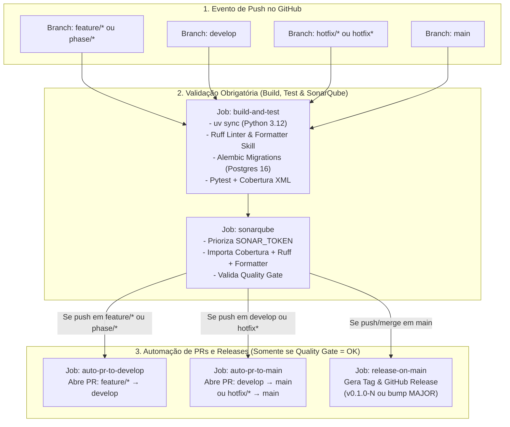

# 🔄 07. Gitflow, CI/CD e Qualidade (SonarQube)

O **Contas** possui uma esteira completa de **Integração e Entrega Contínua (CI/CD)** no GitHub Actions (`.github/workflows/ci.yml`), integrando um modelo **Gitflow automatizado**, **Quality Gate do SonarQube**, **geração automática de Pull Requests e Releases** e sincronização automática da **Wiki**.

---

## 🌿 Estrutura de Branches (Gitflow)

O repositório organiza o ciclo de vida do código nas seguintes branches:

| Branch / Padrão | Origem | Destino (PR Automático) | Finalidade |
| :--- | :--- | :--- | :--- |
| **`feature/*`** e **`phase/*`** | `develop` | `develop` | Desenvolvimento de novas funcionalidades e fases da metodologia Spec-Driven (ex: `feature/021-keycloak-identity-and-auth`). |
| **`develop`** | `main` | `main` | Branch de integração contínua onde as features validadas são consolidadas. |
| **`hotfix/*`** e **`hotfix*`** | `main` | **`main` (Direto)** | Correções urgentes de produção que precisam gerar uma nova Release imediatamente sem aguardar o ciclo da `develop`. |
| **`main`** | `develop` ou `hotfix/*` | *GitHub Release (`v*`)* | Branch estável de produção. Todo push/merge na `main` dispara a criação automática de uma nova Release. |

---

## ⚙️ Fluxo Completo da Esteira de CI/CD

---

## 🚨 Fluxo de Hotfix (`hotfix/*` → `main` → Release)

Quando um problema crítico é identificado em produção:
1. Cria-se uma branch iniciada por `hotfix` a partir da `main` (ex: `hotfix/keycloak-userinfo-split-horizon`).
2. Antes de subir, valida-se localmente com a skill de formatação e o script do SonarQube (`./sonar_check.sh`).
3. Ao executar `git push origin hotfix/...`, o GitHub Actions executa os jobs `build-and-test` e `sonarqube`.
4. Assim que o Quality Gate é aprovado, o job **`auto-pr-to-main`** detecta o prefixo `hotfix` (`startsWith(github.ref, 'refs/heads/hotfix')`) e abre automaticamente um Pull Request **diretamente para a `main`** com o título `hotfix: <nome-da-branch>`.
5. Ao aprovar e fazer o merge desse PR na `main`, o workflow dispara na `main` e executa o job **`release-on-main`**, publicando imediatamente uma nova **GitHub Release** pronta para ser instalada no servidor via `./update_remote.sh`.

---

## 🏷️ Versionamento Automático e Detecção de Breaking Changes

O job `release-on-main` inspeciona automaticamente o histórico de commits desde a última tag:
- **Mudança Estrutural (Major Bump)**: Se detectar commits seguindo a convenção `feat!:`, `fix!:`, `refactor!:`, `BREAKING CHANGE`, `[major]` ou migrações Alembic contendo `_breaking`, incrementa a versão `MAJOR` no `pyproject.toml`, faz commit na `main` e publica a tag `v<MAJOR>.0.0`.
- **Release Incremental**: Caso não haja quebra de compatibilidade, publica a versão atual com o sufixo do build (`v0.1.0-<run_number>`) com notas de release geradas automaticamente pelo GitHub.

---

## 🛡️ Validação Local com SonarQube (`./sonar_check.sh`)

Além do container SonarQube na esteira do GitHub Actions, o projeto conta com validação direta contra o servidor SonarQube local (`dc1` em `http://192.168.1.20:9000`) através do script `./sonar_check.sh`:
1. **Prioridade Estrita do Token (`SONAR_TOKEN`)**: O script utiliza prioritariamente a variável `SONAR_TOKEN` (do ambiente, `.env` ou `.sonar_remote_token`).
2. **Quality Profile (`Contas Python (Sonar way + Formatter)`)**: Combina todas as regras oficiais da *Sonar way* com validação de cobertura (`>= 80%` em código novo) e zero violações de formatação (`ruff format` / `ruff check`).
